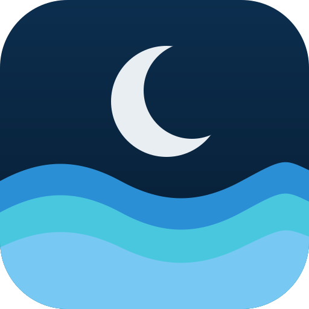
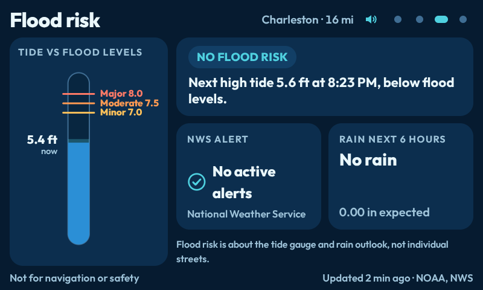
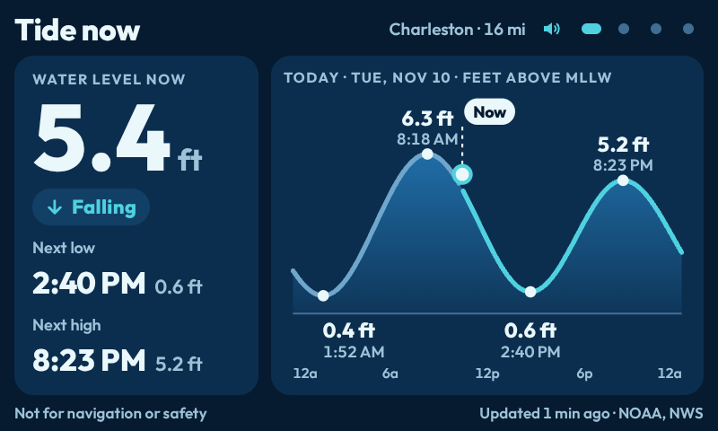
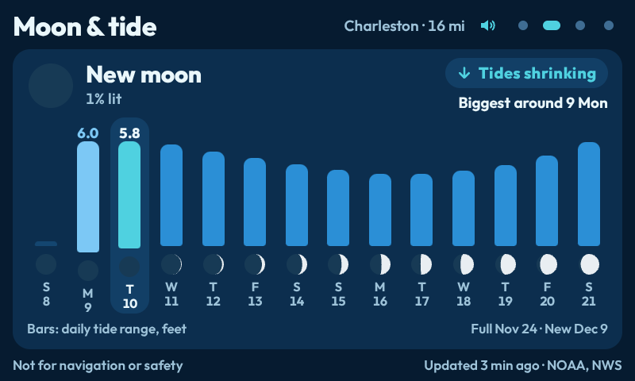
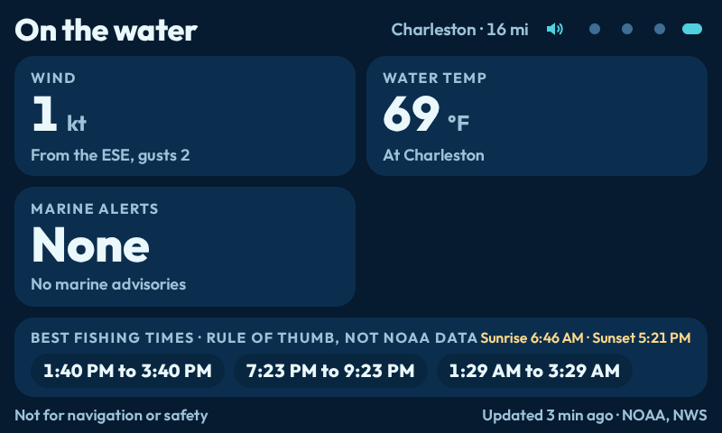

# Tide Thing

<p align="center"></p>

> Built by Thomas Marlowe with help from Claude, an AI tool from Anthropic. More in [docs/how-this-was-built.md](docs/how-this-was-built.md).

Tides, moon phase and flood-risk wording for **US coasts** on a Spotify Car Thing running [bridgething](https://bridgething.com). It sits beside Dash Weather and Plane Thing.

**Not for navigation or safety.** This is a glanceable information screen. Do not use it to decide whether a road, bridge, boat ramp or crossing is safe. Follow official guidance from the National Weather Service and local authorities.

## Screens

Switch with presets 1 to 4, the wheel, or the dots at the top right.

1. **Tide now** – the water level now, rising or falling, next high and low, and a curve for the day.
2. **Moon & tide** – the moon phase and a two-week bar chart of daily tide range (bigger ranges around new and full moon).
3. **Flood risk** – a one-line status about the nearest tide gauge, the rain outlook for the next 6 hours, and the full text of active NWS alerts.
4. **On the water** – wind, water temperature, tide times, sunrise and sunset, plus wave height and marine forecast when a buoy is near. A "best fishing times" strip is a rule of thumb, not NOAA data. Anything a station does not report is hidden.

A slim strip at the top of every screen shows the most severe active NWS alert: red for warnings, amber for watches and advisories. Wheel click turns spoken warnings on or off. Warnings are spoken once each, through the phone.

## Screenshots

Real screenshots from a Car Thing, taken by Thomas on 2026-11-10 with version 0.1.2. They show live NOAA data for the Charleston, SC tide gauge, so the numbers change from hour to hour.

| | |
| --- | --- |
|  |  |
|  |  |

## What it says and does not say

- At a gauge with official flood levels it uses the official categories (minor, moderate, major).
- At a gauge without them it only says **"Higher than usual"** or **"Normal"** compared with that gauge's own usual high tide. It never says "flood" there.
- The flood screen is about the tide gauge and the rain outlook. **It does not know about streets.**
- Old data is kept and labelled "Updated N min ago". The label turns amber after 30 minutes and the flood wording is grayed out after 1 hour.

## Install

1. Download the zip from the latest release (or install from the bridgething store once listed).
2. Open the bridgething companion app on your phone and add the app from the zip.

The app needs your phone's location permission (rounded before use, see Privacy) and the phone connected for data and speech.

## Known limits

- US coasts only. Inland and non-US places show "No NOAA tide station within 150 miles" (the nearest station must be within 150 miles).
- Needs the phone connected. The Car Thing has no internet of its own.
- Speech has been confirmed through the phone's speaker. **Speech over the car speakers has not been tested.**
- The NWS alert lookup could not be tested against the live service from the build environment. The app treats a failed alert lookup as "alerts unavailable", never as "no alerts".
- Official flood levels are converted to the tide-gauge datum using a rule checked at one station (Charleston, SC). Other stations are protected by a plausibility check that falls back to the gauge-relative wording.
- The moon phase uses an average cycle and is good to about half a day.
- Forecast peaks, "heavy rain" thresholds, the "higher than usual" margin and fishing windows are my own simple rules, listed in [docs/design-decisions.md](docs/design-decisions.md). They are not NOAA products.
- The screenshots come from one device on one day at one gauge. Other stations, other coasts and live alerts have not been photographed.

## Privacy

No accounts, no API keys, no tracking, no analytics. Your location is rounded to about 1 km before any request leaves the phone. Details: [docs/privacy.md](docs/privacy.md). Data sources and their limits: [docs/data-sources.md](docs/data-sources.md).

## Documentation

[Architecture](docs/architecture.md) · [Design decisions](docs/design-decisions.md) · [Data sources](docs/data-sources.md) · [Privacy](docs/privacy.md) · [Testing](docs/testing.md) · [Roadmap](docs/roadmap.md) · [FAQ](docs/faq.md) · [How this was built](docs/how-this-was-built.md)

Also: [Contributing](CONTRIBUTING.md) · [Code of conduct](CODE_OF_CONDUCT.md) · [Security](SECURITY.md) · [Third-party notices](THIRD-PARTY-NOTICES.md) · [Changelog](apps/tide-thing/CHANGELOG.md)

## Develop

```sh
bun install
bun run --cwd apps/tide-thing typecheck
bun test apps/tide-thing/src/lib
bun run check          # builds, bundles and validates the catalog
bun run dev            # against a connected Car Thing
```

## Credits and licence

Author: Thomas Marlowe. MIT licence, see [LICENSE](LICENSE). Claude (Anthropic) was used as a tool. Tide, water and buoy data from NOAA; alerts and forecasts from the National Weather Service. This project is not affiliated with NOAA, the NWS, Spotify or bridgething.
